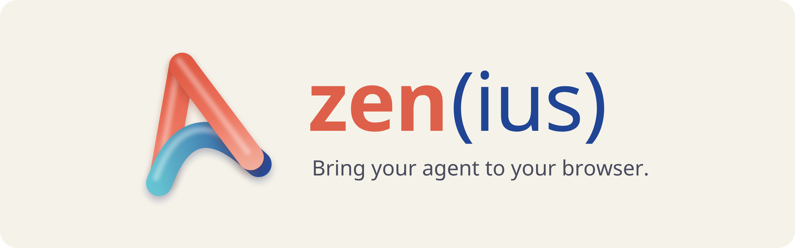
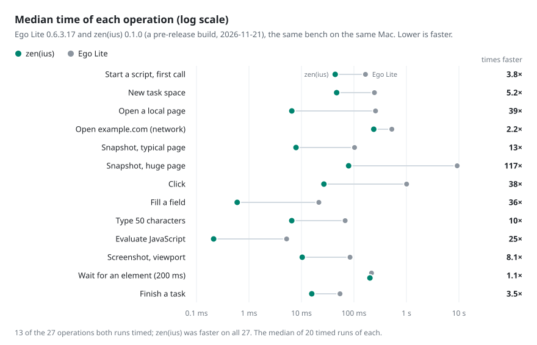
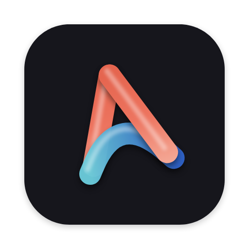
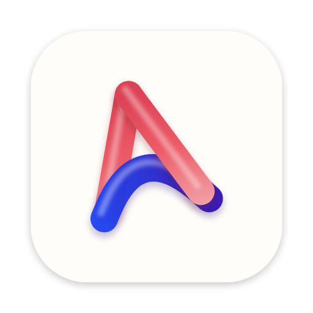
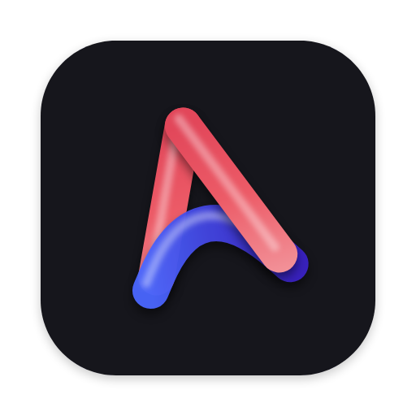

<div align="center">

<picture>
  <source media="(prefers-color-scheme: dark)" srcset="docs/assets/logo/orange-aqua/banner-dark.png" />
  
</picture>

**Bring your agent to your browser.**

<p>
  <a href="https://github.com/zhuconv/zenius/releases/latest"></a>
  <a href="LICENSE"></a>
</p>

<p>
  <b>English</b> ·
  <a href="README.zh-CN.md">简体中文</a>
</p>

</div>

If you want your agent to drive your browser while you keep working, this is
for you. Especially for Zen and Arc users: zen(ius) runs in Zen, with the
same UX and UI you already know.

Each task gets its own tabs in an Agents Space while you keep browsing in
yours: zen(ius) never switches your tab or Space, and never takes your
keyboard focus or your mouse. Open the Agents Space to watch the agent's
cursor act on the real page, take over at any moment, or stop a task from
Zen's sidebar.

There's no second browser to set up and no extension bridge in between.
zen(ius) runs inside Zen, so agents work on the sites you're already signed
in to. Claude Code, Codex or a script of your own drives it through the
`zenius` command and its JavaScript API, or as an MCP server. Zen's sidebar
also gets an agent of its own.

## Demo

https://github.com/user-attachments/assets/8ea1391b-c35d-4df3-8ca4-e99a7da6968a

In the demo, the user reads Wikipedia's article on Kyoto. Meanwhile an
agent, in its own tab, finds places to eat near Kiyomizu-dera on
OpenStreetMap, and asks the user through Needs you.

Map data © [OpenStreetMap contributors](https://www.openstreetmap.org/copyright).
The article is [Kyoto](https://en.wikipedia.org/wiki/Kyoto), from Wikipedia,
under [CC BY-SA 4.0](https://creativecommons.org/licenses/by-sa/4.0/).

## Quick Start

zen(ius) runs on macOS and Linux, with Zen 1.24. It's used daily on macOS
and tested headless on Linux. Windows isn't tested.

### 0. Get Zen

[Zen](https://zen-browser.app) is a free, open-source browser built on
Firefox, with vertical tabs and Spaces, close to Arc's look. zen(ius) runs
inside it. If you already use Zen 1.24, skip to step 1.

- **macOS:** `brew install --cask zen`, or the `.dmg` from
  [zen-browser.app/download](https://zen-browser.app/download).
- **Linux:** `zen.linux-x86_64.tar.xz` (or aarch64) from
  [the same page](https://zen-browser.app/download), unpacked into a folder
  you own. The Flatpak and the AppImage keep Zen's app folder read-only,
  and fx-autoconfig needs its two files there (see below).

Open Zen once so it makes your profile, then quit it.

### 1. Install

Pick one. Each needs [Zen](https://zen-browser.app) and
[Node.js](https://nodejs.org) 22.3 or later.

**1.1 One command**

Quit Zen, then run:

```bash
curl -fsSL https://github.com/zhuconv/zenius/releases/latest/download/install.sh | bash
```

It downloads the latest release and checks its SHA-256. Then it installs
zen(ius) into your Zen profile, the `zenius` command into `~/.local/bin`,
and the zen(ius) skill for Claude Code and Codex. It makes `~/zenius-files`,
the working folder, where your agent's downloads and the files its scripts
write land; `| bash -s -- --working-dir <folder>` names another. For Zen's
sidebar, it adds
the two adapters that run your own Claude Code and Codex there: npm installs
them into `~/.zenius/agents` at pinned versions, with no install scripts
and none of the CLIs they would bundle. It prints each change and backs up
every file it replaces, under `~/.zenius/backups/`. It never quits or
restarts Zen: open Zen again when it's done. The installer is
[`scripts/release-install.sh`](scripts/release-install.sh) with the
release's version and SHA-256 filled in, so you can read what it does
before you run it.

Zen loads zen(ius) through [fx-autoconfig](https://github.com/MrOtherGuy/fx-autoconfig).
If your profile doesn't have fx-autoconfig yet, the installer adds its
loader there. Its other two files go in Zen's app folder, and zen(ius)
leaves Zen's app to you: it changes only your profile, where it backs up
what it replaces and can take everything out again. So when those two files
are missing, the installer ends by printing the two commands that copy
them: run those, then open Zen. A Zen update replaces the app folder and
drops the two files, and zen(ius) stops loading until they're back. Run the
installer again, or `zenius doctor`, and it prints the same two commands.

To read the script before it runs, download it first:

```bash
curl -fsSLO https://github.com/zhuconv/zenius/releases/latest/download/install.sh
less install.sh
bash install.sh             # or later: bash install.sh --uninstall
```

**1.2 Let your agent set it up**

Paste this into Claude Code or Codex:

```
Set up zen(ius) for me: https://github.com/zhuconv/zenius

Read skill/zenius/references/install.md in that repo and follow its steps to install zenius.
```

The agent asks you to quit Zen, and asks before anything that changes your
Zen profile or Zen's app folder.

**1.3 Add the skill with npx**

```bash
npx skills add zhuconv/zenius
```

This adds only the zen(ius) skill to your agents. The first time an agent
needs a browser, the skill finds `zenius` missing and walks you through
installing it.

**Allowing `zenius` in your agent.** A plain `zenius` runs any script with
your own access, so allow or auto-approve `zenius` in Claude Code or Codex
only when it's the sandboxed launcher: its `zenius --version` ends in
`sandboxed`. 1.1's command installs that launcher with
`| bash -s -- --sandbox` instead of `| bash`, with Node 24 first on PATH;
[the install reference](skill/zenius/references/install.md) says what it
allows.

### 2. Try your first task

**In Zen's sidebar.** Press ⌘⇧A (Ctrl+Shift+A on Linux) to open the agent
sidebar. It runs the Claude Code or Codex you've installed, so sign in to
one first, as in a terminal. Choose **+ New task**, or type `>` and your
task in the address bar, for example:

```
> Find the three most-starred Rust web frameworks on GitHub and compare their latest releases
```

The agent opens its own tabs in the Agents Space, and the chat shows each
step as a line you can read: `Open github.com`, `Click "Search"`. A live
card at the end of the chat shows the page it's on. **Watch** takes you to
that tab to see the agent's cursor at work, and ⌃Tab brings you back to your
own tabs. **Take over** hands the page to you; the agent waits until you
press **Resume agent**. When it needs you, for a sign-in, a captcha or a
payment, it hands the task to you with a message in the tab. The sidebar's
task list shows every zen(ius) task, sorted into Needs you, Working and
Done.

**From Claude Code or Codex.** Ask in plain words and mention zen(ius):

```
Use zenius to find this weekend's weather in Tokyo
```

The agent reads the zen(ius) skill, runs `zenius skill` for the usage guide,
then works through short scripts. Each script runs many steps in one call,
in a task of its own that also shows in Zen's sidebar, where you can stop
it. If you'd rather give your agent tools than a shell, register the MCP
server:

```bash
claude mcp add zenius --scope user -- zenius mcp
```

Codex's setup is in [docs/mcp.md](docs/mcp.md).

zen(ius) has no account, no server of its own and no telemetry. Agents
reach Zen through a Unix socket in your home folder, not over the network.
What an agent reads from a page goes to that agent's model provider, as
anything else it reads does.

## Highlights

| Feature | What it does |
|---|---|
| **Your daily Zen, not a second browser** | zen(ius) runs inside the Zen you already use, with your sign-ins and settings, and nothing to migrate. Each task is a set of tabs in the Agents Space. Your own tabs and Spaces stay out of it. |
| **Watch and take over at any moment** | Open the Agents Space, or press Watch on the sidebar's live card, to see the agent's cursor and a label for each action on the real page. Click or type there and zen(ius) asks whether you're taking over. The agent then waits for your Resume agent. |
| **Code, not clicks** | Agents write short JavaScript against zen(ius)'s API: one script goes to a page, fills, clicks, waits and reads in a single call, instead of one command and one look at the page for each step. |
| **Any agent: CLI, SDK or MCP** | Anything that can run a command can drive zen(ius) with `zenius nodejs`, Node programs can import the SDK, and `zenius mcp` serves the same steps as MCP tools, each shown as a step you can read (`Open …`, `Click "…"`). |
| **An agent in Zen's sidebar** | ⌘⇧A opens Claude Code or Codex in the sidebar. Chat answers about the page you're on. Work runs a task in its own tabs, with each step on a line and a live picture of its page. Its agents get the browser and web search, with no shell and no file writes. |
| **Every task in one place** | The sidebar lists every zen(ius) task, whoever started it: the sidebar, an agent in your terminal, or a script, with where each came from. Stop one there, and its agent's next step ends with a clear stop. |
| **Safety that acts on evidence** | zen(ius) trusts the agent and stays out of your way until there's evidence. If the agent's code left something in a page that could catch what you type, the page is reloaded clean before you use it. A page on Safe Browsing's lists, or one the agent flagged, shows you a warning. Your saved logins and cards fill nothing in while the agent drives, and the passwords, card details and one-time codes filled while you hold a tab are cleared before the agent gets it back. |

## zen(ius) and other tools

Many tools let an agent drive a browser. What differs is which browser the
agent gets, whether you can keep working beside it, and which agents can use
it. Each column below is one product of its kind.

| | zen(ius) | [Ego Lite](https://github.com/citrolabs/ego-lite) | [Claude in Chrome](https://claude.com/claude-in-chrome)<br><sub>extension</sub> | [Claude Cowork](https://support.claude.com/en/articles/16607400-use-the-built-in-browser-in-claude-cowork)<br><sub>built-in browser</sub> | [Browserbase](https://docs.browserbase.com/welcome/introduction)<br><sub>cloud browser</sub> | [playwright-cli](https://github.com/microsoft/playwright-cli)<br><sub>browser CLI</sub> | [Comet](https://www.perplexity.ai/hub/blog/comet-is-now-available-to-everyone-worldwide)<br><sub>AI browser</sub> |
|---|:---:|:---:|:---:|:---:|:---:|:---:|:---:|
| Works with any agent: Claude Code, Codex, a script | ✓ | ✓ | Claude's apps | Claude's apps | ✓ | ✓ | its assistant |
| Works in the browser you already use | Zen | — | Chrome¹ | — | — | Chrome, Edge² | — |
| Uses your existing sign-ins | ✓ | after import | ✓ | after import, site by site | after import | ✓² | after import |
| You keep browsing while the agent works | ✓ | ✓ | ✓ | ✓ | ✓ | ✓ | Max plan |
| Watch the agent live | ✓ | ✓ | ✓ | ✓ | ✓ | ✓ | ✓ |
| Take over mid-task | ✓ | ✓ | ✓ | | ✓ | ✓ | |
| Free | ✓ | ✓ | — | — | free tier | ✓ | browser only³ |
| Runs on | macOS, Linux | macOS, Windows | macOS, Windows; Linux with Claude Code | macOS, Windows, Linux (beta) | the cloud | macOS, Linux, Windows | macOS, Windows, Android, iOS |

✓ yes, — no, blank: the product's docs don't say. zen(ius) and Ego Lite are
marked from our own use. The other columns come from each product's public
docs as of 2026-11-21, and the [sources](#sources-for-the-table) quote the
page behind each mark. Tell us in an issue if one is wrong or out of date.

¹ Its help center and Chrome Web Store listing say Chrome only. Claude
Code's docs add Edge, and say Claude Code also connects in Brave, Arc,
Vivaldi and Opera.

² Through the Playwright Extension in Chrome or Edge
(`playwright-cli attach --extension=chrome`), or by attaching to a running
Chrome or Edge with remote debugging on (`playwright-cli attach --cdp=chrome`).
Otherwise playwright-cli starts its own browser, with the profile kept in
memory.

³ The Comet browser is free. Perplexity's plan table lists no Comet
Assistant queries on Free; Pro and Max have monthly limits.

zen(ius) is open source under MIT, the part that runs inside Zen included.
Ego Lite's repository is MIT too, and its browser is a separate, free
download.

### Sources for the table

<details>
<summary>The page and a quote behind each mark in the other tools' columns</summary>

**Claude in Chrome:** [help center](https://support.claude.com/en/articles/12012173-get-started-with-claude-in-chrome),
[Claude Code docs](https://code.claude.com/docs/en/chrome),
[product page](https://claude.com/claude-in-chrome),
[Chrome Web Store](https://chromewebstore.google.com/detail/claude/fcoeoabgfenejglbffodgkkbkcdhcgfn)

- Any agent: "You can launch Claude in Chrome tasks from the side panel in
  your Chrome browser, or through Claude Cowork or Claude Code." (help center)
- Your browser: "Claude in Chrome is a browser extension that lets Claude work
  on the web pages you have open." (product page) "Claude in Chrome is not
  supported on other Chromium-based web browsers or mobile devices." (help
  center) "Chrome integration works with Google Chrome and Microsoft Edge.
  Claude Code also detects the extension and sets up the connection in other
  Chromium-based browsers, including Brave, Arc, Vivaldi, and Opera." (Claude
  Code docs)
- Sign-ins: "Claude opens new tabs for browser tasks and shares your browser's
  login state, so it can access any site you're already signed into." (Claude
  Code docs)
- Browsing beside it: "This lets Claude organize tabs it opens into a separate
  group with a different color", and it "keeps working even when you switch
  tabs (as long as Chrome is open)". (help center)
- Watch, take over: "You watch it happen, and you step in whenever you want
  to." (Chrome Web Store) "Browser actions run in a visible Chrome window in
  real time." (Claude Code docs)
- Free: "Claude in Chrome is available on paid plans (Pro, Max, Ultra, Team,
  and Enterprise)" (help center)
- Runs on: its "Extension not detected" section names the native messaging
  host's place on macOS, Linux and Windows, and "Chrome integration isn’t
  supported in Windows Subsystem for Linux (WSL)." (Claude Code docs) Without
  Claude Code, the listing names "The Claude desktop app for Mac or Windows".
  (Chrome Web Store)

**Claude Cowork's built-in browser:** [help center](https://support.claude.com/en/articles/16607400-use-the-built-in-browser-in-claude-cowork),
[getting started](https://support.claude.com/en/articles/13345190-get-started-with-claude-cowork),
[admin setting](https://support.claude.com/en/articles/16635803-set-up-browser-use-in-claude-cowork-for-team-and-enterprise-plans),
[launch article, August 26, 2026](https://claude.com/resources/articles/cowork-built-in-browser)

- Any agent, runs on: "The built-in browser is available in Cowork in Claude
  Desktop for macOS, Windows, and Linux (beta)" (help center) Its setting "also
  covers the browser in Claude Code: while it's off, that browser on the latest
  desktop app opens only local development servers." (admin setting)
- Your browser: "The built-in browser is separate from your own browser."
  (help center)
- Sign-ins: "Claude doesn't see your saved logins unless you choose to import
  them." "Import works site by site." (help center)
- Browsing beside it: "The built-in browser is for handing web tasks to Claude
  while you keep working" (launch article)
- Watch: "Claude opens sites, reads pages, clicks, types, and fills forms while
  you watch, with no need to switch windows." (help center)
- Free: "Cowork is available to paid Claude plans (Pro, Max, Ultra, Team,
  Enterprise) only." (getting started)

**Browserbase:** [introduction](https://docs.browserbase.com/welcome/introduction),
[contexts](https://docs.browserbase.com/platform/browser/core-features/contexts),
[cookie sync](https://docs.browserbase.com/integrations/skills/cookie-sync),
[1Password](https://docs.browserbase.com/integrations/1password/agentic-autofill),
[live view](https://docs.browserbase.com/platform/browser/observability/session-live-view),
[pricing](https://www.browserbase.com/pricing)

- Any agent, your browser, browsing beside it, runs on: "One API key gives your
  agent access to cloud browsers" (introduction)
- Sign-ins: "By default, each Browserbase session starts with a fresh user data
  directory" (contexts), and its cookie sync skill can "Sync local Chrome
  cookies to a Browserbase persistent context so your browser agent can work
  with authenticated websites." (cookie sync) "Use 1Password Agentic Autofill
  to approve and fill logins in a Browserbase session." (1Password)
- Watch, take over: "On any running browser session - watch, click, type, and
  scroll in real-time." "Human in the loop - instantly take control or provide
  input" (live view)
- Free: the "Free Plan" at "$0/mo", with "1 browser hour" (pricing)

**playwright-cli:** [README](https://github.com/microsoft/playwright-cli),
[LICENSE](https://github.com/microsoft/playwright-cli/blob/main/LICENSE),
[Playwright MCP's README](https://github.com/microsoft/playwright-mcp),
[attach](https://playwright.dev/agent-cli/commands/attach),
[sessions](https://playwright.dev/agent-cli/sessions)

- Install: `npm install -g @playwright/cli@latest`, so its npm package is
  `@playwright/cli`. (README)
- Any agent: "Claude Code, GitHub Copilot, or any other coding agent." (README)
- Your browser, sign-ins: `playwright-cli attach --extension=chrome` connects
  through the Playwright Extension (README). Its option reads "Connect to a
  running browser instance (Edge/Chrome only).", and it "allows you to connect
  to existing browser tabs and leverage your logged-in sessions and browser
  state." (Playwright MCP's README) `playwright-cli attach --cdp=chrome` is to
  "attach to running Chrome/Edge by channel" (README), and "The browser must
  have remote debugging enabled" (attach). Otherwise, "Playwright CLI keeps the
  browser profile in memory by default." (README)
- Browsing beside it: "When attaching via the Playwright Extension, the session
  controls only the tabs selected by the user and the tabs it opens." (README)
- Watch, take over: "Use `playwright-cli show` to open a visual dashboard that
  lets you see and control all running browser sessions." "Click into the
  viewport to take over mouse and keyboard input; press Escape to release."
  (README)
- Free: the Apache License, Version 2.0. (LICENSE)
- Runs on: the sessions page gives where a session's profile lives on macOS,
  Linux and Windows. (sessions)

**Comet:** [Comet Assistant](https://www.perplexity.ai/hub/blog/comet-assistant-puts-you-in-control),
[importing data](https://www.perplexity.ai/help-center/comet/en/articles/12657736-import-data),
[changelog, October 2, 2025](https://www.perplexity.ai/changelog/what-we-shipped-october-3rd),
[free launch, October 2, 2025](https://www.perplexity.ai/hub/blog/comet-is-now-available-to-everyone-worldwide),
[plans](https://www.perplexity.ai/help-center/en/articles/11187416-which-perplexity-subscription-plan-is-right-for-you),
[changelog, March 26, 2026](https://www.perplexity.ai/changelog/what-we-shipped--march-27-2026)

- Any agent, watch: "You can watch while Comet works or see its reasoning
  step-by-step in the Assistant sidecar." (Comet Assistant)
- Your browser, sign-ins: "When you first open Comet, you'll be asked if you'd
  like to bring your data from another browser." "Choose one, pick what to
  import (bookmarks, passwords, cookies, history, extensions), and click
  Import." (importing data)
- Browsing beside it: under "Background Assistants", "With Comet, Max
  subscribers can now launch many agentic tasks in parallel and manage
  confirmations and follow ups in a single page." (changelog, October 2, 2025)
- Free: "Today we are releasing the Comet browser to the world, for free."
  (free launch) The plan table's row "Browser Agent (Comet Assistant) Queries"
  reads "No" for Free, "Monthly limits (average use)" for Pro and "Monthly
  limits (advanced use)" for Max. (plans)
- Runs on: "This week, Perplexity launched Comet to all iOS users. With this
  release, Comet is now available on all major platforms: iOS, Android, Mac,
  and Windows." (changelog, March 26, 2026)

**Ego Lite:** marked from our own use. Its [README](https://github.com/citrolabs/ego-lite)
says "ego lite runs on macOS and Windows, and Linux is on the roadmap." and
"The contents of this repository are released under the MIT License. The ego
lite browser is a separate, free download."

</details>

## Benchmarks

zen(ius) is faster than [Ego Lite](https://github.com/citrolabs/ego-lite) on every operation the bench timed on both,
passes every case of Ego Lite's own end-to-end suite that applies to it,
did every live task in both rounds, and used less CPU and memory per round.
Each number below links to its report in [`docs/eval/`](docs/eval/), which
names the build it ran on.

<div align="center">

<picture>
  <source media="(prefers-color-scheme: dark)" srcset="docs/assets/benchmarks-dark.svg" />
  
</picture>

</div>

**Speed** ([report](docs/eval/bench-comparison.md)). Both ran the same bench,
`tests/bench/bench.mjs`, on the same Mac: each operation 20 times after 2
warm-ups. zen(ius)'s median was lower on
[all 27 operations, 16 of them by 10× or more](docs/eval/bench-comparison.md),
and the median operation was [13× faster](docs/eval/bench-comparison.md). A
click took [27 ms against Ego Lite's 1.0 s](docs/eval/bench-comparison.md),
and a snapshot of a huge page
[79 ms against 9.3 s](docs/eval/bench-comparison.md). The report has each
p95 too.

**Parity** ([report](docs/eval/e2e-zenius.md)). We ported Ego Lite's own
real-browser e2e suite (83 cases, v2.2.1) to `tests/e2e/`.
[All 67 cases that apply to zen(ius) pass, and none is flaky](docs/eval/e2e-zenius.md).
Of the other 16, 15 test what zen(ius) doesn't have (Ego Lite's legacy v1
helpers, CDP itself and Chromium's PDF viewer), and one tests a service
worker in a task's page, which zen(ius) refuses on purpose.

**Live tasks** ([round 1](docs/eval/live-round1.md),
[round 2](docs/eval/live-round2.md)). 14 tasks on public sites from
[`live-tasks.md`](docs/eval/live-tasks.md), in two rounds. The list has 15;
T9's site, Project Gutenberg, was down both times. Every run had one browser skill, zen(ius)'s or Ego
Lite's, with WebFetch and WebSearch off, and the same agent and judge:
Claude Code 2.1.330 with Opus 5.5 at effort xhigh.

| Full successes | Round 1 | Round 2 | Both rounds |
|---|---|---|---|
| zen(ius) | [14/14](docs/eval/live-round1.md) | [14/14](docs/eval/live-round2.md) | [28/28](docs/eval/live-round2.md) |
| Ego Lite, as judged | [12/14](docs/eval/live-round1.md) | [14/14](docs/eval/live-round2.md) | [26/28](docs/eval/live-round2.md) |
| Ego Lite, after hand checks | [13/14](docs/eval/live-round1.md) | [14/14](docs/eval/live-round2.md) | [27/28](docs/eval/live-round2.md) |
| Fisher's exact test, two-sided | [p = 0.48](docs/eval/live-round1.md) | | [p = 0.49](docs/eval/live-round2.md) |
| Agent cost, zen(ius) / Ego Lite | [$3.31 / $3.40](docs/eval/live-round1.md) | [$3.46 / $3.56](docs/eval/live-round2.md) | |

**That isn't a significant difference.** Both can do these tasks, and 28 runs
each can't rank them; after hand checks the test gives
[p = 1.0](docs/eval/live-round2.md). Ego Lite's two misses in round 1 weren't
its browser's: one prompt read two ways, and the judge couldn't see
screenshots. Round 2 fixed both.

**No preemption** ([report](docs/eval/no-preemption.md)). An agent must never
take your tab, Space, window, keyboard focus or pointer. We ran the same
probe on both browsers while sampling every window on screen and the app in
front twice a second, without window titles or screen captures. During a
dialog case, [Ego Lite's main window came on screen](docs/eval/no-preemption.md).
zen(ius) brought no window forward, except on round 2's build, where
[an agent's middle click on a link brought Zen to the front](docs/eval/no-preemption.md):
Zen raises a window before it loads a link into it. zen(ius) now opens such a
link without raising Zen: on the release candidate,
[nothing came forward](docs/eval/no-preemption.md), neither for the middle
click nor for a popup that `window.open` gives a size.

**Memory and CPU** ([report](docs/eval/footprint-comparison.md)). One run
each, on the same Mac: the same script five times in each browser, with its
whole process tree sampled every 2 s.

| | zen(ius) | Ego Lite |
|---|---|---|
| Processes in the tree | [10 to 11](docs/eval/footprint-comparison.md) | [48 to 55](docs/eval/footprint-comparison.md) |
| Time per round, median | [576 ms](docs/eval/footprint-comparison.md) | [2,068 ms](docs/eval/footprint-comparison.md) |
| CPU per round, above the background | [0.51 CPU-s](docs/eval/footprint-comparison.md) | [3.0 CPU-s](docs/eval/footprint-comparison.md) |
| Memory added during the rounds, at the peak | [+122 MiB](docs/eval/footprint-comparison.md) | [+825 MiB](docs/eval/footprint-comparison.md) |
| The browser without its pages | [950 MiB](docs/eval/footprint-comparison.md), the whole tree | [969 MiB](docs/eval/footprint-comparison.md), plus [351 MiB](docs/eval/footprint-comparison.md) in 5 extension processes |

Memory and CPU at rest aren't compared: Ego Lite's start brought up
[45 renderer processes](docs/eval/footprint-comparison.md) in its first minute, which looks like
its saved session reopening, while zen(ius) ran on a fresh profile. Ego Lite's background CPU was still settling, so its
CPU per round runs from [0.6 to 3.4 CPU-s](docs/eval/footprint-comparison.md),
depending on the stretch of background it's measured against. zen(ius)'s
background stayed near zero.

## Docs

- [Install guide](skill/zenius/references/install.md), and the
  [step-by-step daily install](docs/install-daily.md) we use ourselves
- [Design](docs/SPEC.md): what zen(ius) is for and how it's built
- [Protocol](docs/PROTOCOL.md): the contract between the SDK and the runtime
  in Zen
- [Runtime internals](docs/SPI.md)
- [The MCP server](docs/mcp.md) and [the agent sidebar](docs/agent-sidebar.md)
- [Evaluation results](docs/eval/README.md) against Ego Lite
- Building from source: `(cd sdk && npm ci)`, then `scripts/test-all.sh`
  runs every suite headless; `scripts/zen-dev.sh` starts a dev Zen on a
  profile of its own

## Community

Questions, bugs and ideas: [GitHub Issues](https://github.com/zhuconv/zenius/issues).

## Star History

<a href="https://star-history.com/#zhuconv/zenius&Date">
  <picture>
    <source media="(prefers-color-scheme: dark)" srcset="https://api.star-history.com/svg?repos=zhuconv/zenius&type=Date&theme=dark" />
    
  </picture>
</a>

## Logo

The zen(ius) mark stands for the agent's cursor. Its design draws on the Arc
browser's icon: an A whose crossbar is an arch, with the A's apex as the
cursor's tip. The main mark is an orange A with an aqua arch; the alternate is
a red A with a blue arch. Each comes light and dark, as SVG and PNG.

| | Light | Dark | Files |
|---|---|---|---|
| Orange and aqua (main) |  |  | [orange-aqua](docs/assets/logo/orange-aqua/) |
| Red and blue |  |  | [red-blue](docs/assets/logo/red-blue/) |

## License

zen(ius) is released under the [MIT License](LICENSE). Parts from others keep
their own licenses, listed in [THIRD_PARTY.md](THIRD_PARTY.md): portions are
adapted from [citrolabs/ego-lite](https://github.com/citrolabs/ego-lite)
(MIT), and [fx-autoconfig](https://github.com/MrOtherGuy/fx-autoconfig)
(MPL-2.0) is included unchanged. Zen Browser is MPL-2.0 and a separate
download from [zen-browser.app](https://zen-browser.app).

The zen(ius) logo is the project's own. Zen Browser's name belongs to the
Zen Browser project: zen(ius) is not an official Zen Browser project, and
isn't affiliated with Zen Browser, Mozilla or CitroLabs.
