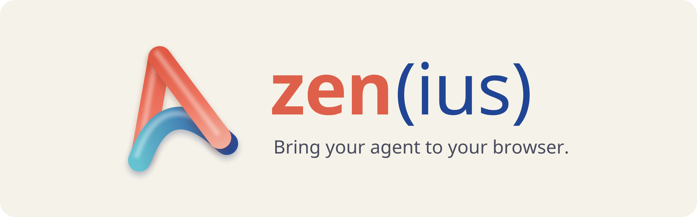
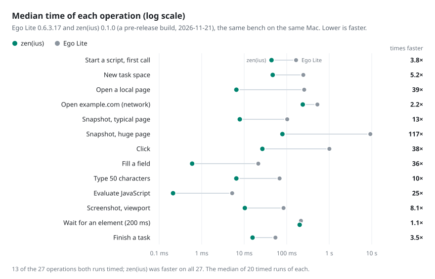
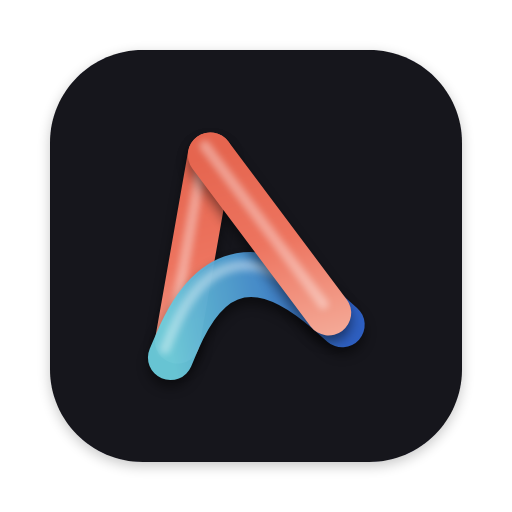
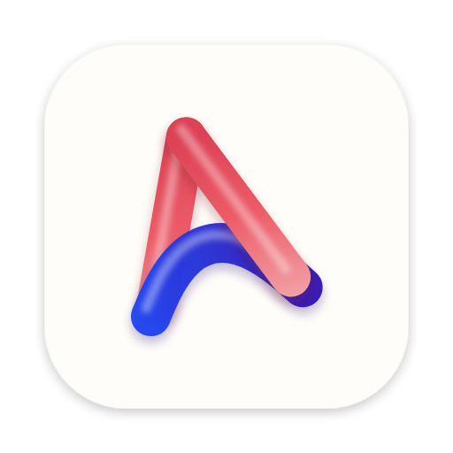
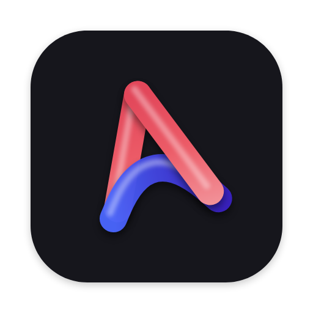

<div align="center">

<picture>
  <source media="(prefers-color-scheme: dark)" srcset="docs/assets/logo/aqua-navy/banner-dark.png" />
  
</picture>

**把你的 Agent 带进你的浏览器**

<p>
  <a href="https://github.com/zhuconv/zenius/releases/latest"></a>
  <a href="LICENSE"></a>
</p>

<p>
  <a href="README.md">English</a> ·
  <b>简体中文</b>
</p>

</div>

如果你想让 Agent 操作你的浏览器，同时你自己照常干活，那它就是为你做的。尤其适合 Zen 和 Arc 的用户：zen(ius) 运行在 Zen 里，界面和操作方式都是你熟悉的那一套。

每个任务都在 Agents Space 里有自己的一组标签页，你照常在自己的 Space 里浏览：zen(ius) 从不切换你的标签页或 Space，也从不抢你的键盘焦点和鼠标。打开 Agents Space，就能看到 Agent 的光标在真实页面上操作；你可以随时接管，也可以在 Zen 的侧边栏里停止任务。

不用再装第二个浏览器，中间也没有扩展来桥接。zen(ius) 就运行在 Zen 里面，所以 Agent 直接在你已经登录的网站上工作。Claude Code、Codex 或你自己写的脚本，都可以通过 `zenius` 命令和它的 JavaScript API 来驱动它，也可以把它当作 MCP 服务器来用。Zen 的侧边栏里还有一个自带的 Agent。

## 演示

https://github.com/user-attachments/assets/eab70814-e6da-481f-ab1f-0e3ee8b4f15d

演示里，用户在读维基百科的京都条目。与此同时，一个 Agent 在它自己的标签页里，在 OpenStreetMap 上找清水寺附近吃饭的地方，并通过 Needs you 向用户提问。

地图数据 © [OpenStreetMap contributors](https://www.openstreetmap.org/copyright)。文章是维基百科的 [Kyoto](https://en.wikipedia.org/wiki/Kyoto) 条目，采用 [CC BY-SA 4.0](https://creativecommons.org/licenses/by-sa/4.0/) 许可。

## 快速开始

zen(ius) 支持 macOS 和 Linux，配合 Zen 1.24 使用。我们每天在 macOS 上用它，并在 Linux 上做无头测试。Windows 尚未测试。

### 0. 安装 Zen

[Zen](https://zen-browser.app) 是一款基于 Firefox 的免费开源浏览器，有竖排标签页和 Spaces，界面和 Arc 很接近。zen(ius) 就运行在它里面。已经在用 Zen 1.24 的话，直接跳到第 1 步。

- **macOS：** `brew install --cask zen`，或者从 [zen-browser.app/download](https://zen-browser.app/download) 下载 `.dmg`。
- **Linux：** 从[同一页面](https://zen-browser.app/download)下载 `zen.linux-x86_64.tar.xz`（或 aarch64 版），解压到你自己有写权限的文件夹。Flatpak 和 AppImage 版本的程序文件夹是只读的，而 fx-autoconfig 需要在那里放两个文件（见下文）。

先打开一次 Zen，让它创建你的配置文件，然后退出。

### 1. 安装

任选一种。都需要先装好 [Zen](https://zen-browser.app) 和 [Node.js](https://nodejs.org) 22.3 或更高版本。

**1.1 一条命令**

先退出 Zen，然后运行：

```bash
curl -fsSL https://github.com/zhuconv/zenius/releases/latest/download/install.sh | bash
```

它会下载最新的发布包并校验 SHA-256，然后把 zen(ius) 装进你的 Zen 配置文件（profile），把 `zenius` 命令装到 `~/.local/bin`，并为 Claude Code 和 Codex 装上 zen(ius) Skill。它还会为 Zen 侧边栏装上两个适配器，让侧边栏运行你自己的 Claude Code 和 Codex：由 npm 按锁定的版本装到 `~/.zenius/agents`，不运行安装脚本，也不带它们原本捆绑的 CLI。每一处改动它都会打印出来，被替换的文件都备份在 `~/.zenius/backups/` 下。它从不退出或重启 Zen：装完后重新打开 Zen 即可。安装程序就是本仓库的 [`scripts/release-install.sh`](scripts/release-install.sh)，只是填入了该版本的版本号和 SHA-256，运行前可以先读一读它做了什么。

Zen 通过 [fx-autoconfig](https://github.com/MrOtherGuy/fx-autoconfig) 加载 zen(ius)。如果你的配置文件里还没有 fx-autoconfig，安装程序会把它的加载器装进去。它另外两个文件要放在 Zen 的应用目录里，而 zen(ius) 把 Zen 的应用留给你自己处理：它只改动你的配置文件，在那里备份它替换的文件，也能把装的东西全部撤掉。所以缺这两个文件时，安装程序最后会打印出复制它们的两条命令：运行这两条命令，再打开 Zen 即可。Zen 更新时会替换整个应用目录，这两个文件也会随之消失，zen(ius) 就会停止加载，直到你把它们复制回去。再运行一次安装程序，或者运行 `zenius doctor`，都会再次打印这两条命令。

想先读一遍脚本再运行，就先把它下载下来：

```bash
curl -fsSLO https://github.com/zhuconv/zenius/releases/latest/download/install.sh
less install.sh
bash install.sh             # 以后卸载：bash install.sh --uninstall
```

**1.2 让 Agent 帮你装**

把下面这段粘贴进 Claude Code 或 Codex：

```
帮我装好 zen(ius)：https://github.com/zhuconv/zenius

阅读该仓库里的 skill/zenius/references/install.md，按步骤安装 zenius。
```

Agent 会请你先退出 Zen；任何会改动你的 Zen 配置文件或 Zen 应用目录的操作，它都会先问你。

**1.3 用 npx 添加 Skill**

```bash
npx skills add zhuconv/zenius
```

这只会给你的 Agent 添加 zen(ius) Skill。Agent 第一次需要浏览器时，Skill 会发现还没装 `zenius`，并带你一步步装好。

### 2. 跑第一个任务

**在 Zen 的侧边栏里。** 按 ⌘⇧A（Linux 上是 Ctrl+Shift+A）打开 Agent 侧边栏。它运行的是你已经装好的 Claude Code 或 Codex，所以请先像在终端里一样登录其中一个。点 **+ New task**，或者在地址栏输入 `>` 再写上你的任务，例如：

```
> 在 GitHub 上找出 star 最多的三个 Rust Web 框架，比较它们的最新版本
```

Agent 会在 Agents Space 里打开自己的标签页，聊天里的每一步都是一行看得懂的文字：`Open github.com`、`Click "Search"`。聊天末尾有一张实时卡片，显示它正在操作的页面。**Watch** 会带你到那个标签页，看 Agent 的光标在干活，⌃Tab 再带你回到自己的标签页。**Take over** 把页面交给你，Agent 会一直等到你按下 **Resume agent**。需要你出手时，比如登录、验证码或付款，它会把任务交给你，并在标签页里留言说明。侧边栏的任务列表会显示所有 zen(ius) 任务，按 Needs you、Working 和 Done 分组。

**在 Claude Code 或 Codex 里。** 用平常的话提要求，并提到 zen(ius)：

```
用 zenius 查一下东京这个周末的天气
```

Agent 会读取 zen(ius) Skill，运行 `zenius skill` 拿到使用指南，然后通过一段段短脚本完成任务。每段脚本在一次调用里跑完多个步骤；任务有自己的一组标签页，同样会出现在 Zen 的侧边栏里，你可以在那里停止它。如果你更想给 Agent 工具而不是 shell，可以注册 MCP 服务器：

```bash
claude mcp add zenius --scope user -- zenius mcp
```

Codex 的配置方法见 [docs/mcp.md](docs/mcp.md)。

zen(ius) 没有账号，没有自己的服务器，也没有遥测。Agent 通过你主目录下的一个 Unix 套接字连接 Zen，不走网络。Agent 从页面上读到的内容会发给该 Agent 的模型服务商，就像它读到的其他内容一样。

## 亮点

| 功能 | 作用 |
|---|---|
| **就是你日常用的 Zen，不是第二个浏览器** | zen(ius) 运行在你已经在用的 Zen 里，带着你的登录状态和设置，什么都不用迁移。每个任务是 Agents Space 里的一组标签页，你自己的标签页和 Space 不受影响。 |
| **随时观看，随时接管** | 打开 Agents Space，或在侧边栏的实时卡片上点 Watch，就能在真实页面上看到 Agent 的光标和每个动作的说明。你在那里一点击或打字，zen(ius) 就会问你是否要接管，之后 Agent 会等你按 Resume agent。 |
| **写代码，而不是一下下点** | Agent 用 zen(ius) 的 API 写简短的 JavaScript：一段脚本就能在一次调用里打开页面、填写、点击、等待、读取，而不是每一步都要一条命令、再看一次页面。 |
| **任何 Agent：CLI、SDK 或 MCP** | 能运行命令的程序都能用 `zenius nodejs` 驱动 zen(ius)，Node 程序可以直接引入 SDK，`zenius mcp` 则把同样的步骤做成 MCP 工具，每一步都显示成一行看得懂的文字（`Open …`、`Click "…"`）。 |
| **Zen 侧边栏里的 Agent** | 按 ⌘⇧A 就能在侧边栏里打开 Claude Code 或 Codex。Chat 针对你正在看的页面回答问题；Work 在自己的标签页里执行任务，每一步一行，并附上它所在页面的实时画面。侧边栏里的 Agent 能用浏览器和网页搜索，但没有 shell，也不能写文件。 |
| **所有任务一目了然** | 侧边栏会列出所有 zen(ius) 任务，不管是谁发起的：侧边栏自己、你终端里的 Agent，还是一段脚本，并注明每个任务的来源。在那里停止某个任务，它的 Agent 下一步就会收到明确的停止。 |
| **基于证据的安全，平时不打扰** | zen(ius) 信任 Agent，在出现证据之前不挡你的路。如果 Agent 的代码在页面里留下了可能截获你输入的东西，在你使用这个页面之前，它会被重新加载成干净的版本。上了 Safe Browsing 名单的页面，或被 Agent 标记的页面，会给你显示警告。Agent 操作时，你保存的登录信息和银行卡不会自动填入；你接管标签页时填入的密码、银行卡信息和一次性验证码，在 Agent 拿回这个标签页之前会被清除。 |

## zen(ius) 与其他工具的对比

很多工具都能让 Agent 操控浏览器。真正的区别在于：Agent 用的是哪个浏览器，你能不能在旁边照常工作，以及哪些 Agent 能用它。下表每一列是同类工具中的一个产品。

| | zen(ius) | [Ego Lite](https://github.com/citrolabs/ego-lite) | [Claude in Chrome](https://claude.com/claude-in-chrome)<br><sub>浏览器扩展</sub> | [Claude Cowork](https://support.claude.com/en/articles/16607400-use-the-built-in-browser-in-claude-cowork)<br><sub>内置浏览器</sub> | [Browserbase](https://docs.browserbase.com/welcome/introduction)<br><sub>云浏览器</sub> | [playwright-cli](https://github.com/microsoft/playwright-cli)<br><sub>浏览器 CLI</sub> | [Comet](https://www.perplexity.ai/hub/blog/comet-is-now-available-to-everyone-worldwide)<br><sub>AI 浏览器</sub> |
|---|:---:|:---:|:---:|:---:|:---:|:---:|:---:|
| 适用于任何 Agent：Claude Code、Codex、脚本 | ✓ | ✓ | Claude 自家的应用 | Claude 自家的应用 | ✓ | ✓ | 它自带的助手 |
| 就在你已经在用的浏览器里工作 | Zen | — | Chrome¹ | — | — | Chrome、Edge² | — |
| 使用你现有的登录状态 | ✓ | 导入之后 | ✓ | 逐个网站导入之后 | 导入之后 | ✓² | 导入之后 |
| Agent 工作时你照常浏览 | ✓ | ✓ | ✓ | ✓ | ✓ | ✓ | Max 套餐 |
| 实时观看 Agent | ✓ | ✓ | ✓ | ✓ | ✓ | ✓ | ✓ |
| 中途接管 | ✓ | ✓ | ✓ | | ✓ | ✓ | |
| 免费 | ✓ | ✓ | — | — | 有免费档 | ✓ | 仅浏览器³ |
| 支持的平台 | macOS、Linux | macOS、Windows | macOS、Windows；Linux 需配合 Claude Code | macOS、Windows、Linux（测试版） | 云端 | macOS、Linux、Windows | macOS、Windows、Android、iOS |

✓ 表示是，— 表示否，空白表示该产品的文档没有说明。zen(ius) 和 Ego Lite 的标记来自我们自己的使用；其他各列来自各产品的公开文档（2026-11-21 核对），每个标记依据的页面和原文摘录见英文 README 的[来源列表](README.md#sources-for-the-table)。如有标记错误或已经过时，欢迎提 issue 告诉我们。

¹ 它的帮助中心和 Chrome 应用商店页面都说只支持 Chrome；Claude Code 的文档则加上了 Edge，并说 Claude Code 也能在 Brave、Arc、Vivaldi 和 Opera 里建立连接。

² 通过 Chrome 或 Edge 里的 Playwright 扩展（`playwright-cli attach --extension=chrome`），或者连接到一个已开启远程调试的 Chrome 或 Edge（`playwright-cli attach --cdp=chrome`）。两者都不用时，playwright-cli 会启动它自己的浏览器，配置文件只保存在内存里。

³ Comet 浏览器本身免费。Perplexity 的套餐对照表里，Free 没有 Comet Assistant 的查询次数，Pro 和 Max 每月有限额。

zen(ius) 以 MIT 许可证开源，运行在 Zen 里的那部分也包括在内。Ego Lite 的代码仓库同样采用 MIT，它的浏览器则是单独的免费下载。

## 基准测试

在基准测试里两边都计时的每一项操作上，zen(ius) 都比 [Ego Lite](https://github.com/citrolabs/ego-lite) 快；Ego Lite 自己的端到端测试中，适用于 zen(ius) 的用例它全部通过；两轮实测任务它也全部完成；每轮用的 CPU 和内存也更少。下面每个数字都链接到 [`docs/eval/`](docs/eval/) 里的报告，报告里写明了每次运行用的构建。

<div align="center">

<picture>
  <source media="(prefers-color-scheme: dark)" srcset="docs/assets/benchmarks-dark.svg" />
  
</picture>

</div>

**速度**（[报告](docs/eval/bench-comparison.md)）。两边在同一台 Mac 上跑同一套基准 `tests/bench/bench.mjs`：每项操作先预热 2 次，再计时 20 次。zen(ius) 的中位数[在全部 27 项操作上都更低，其中 16 项快 10 倍以上](docs/eval/bench-comparison.md)，居中的那项操作快 [13 倍](docs/eval/bench-comparison.md)。点击一次，zen(ius) 要 [27 ms，Ego Lite 要 1.0 s](docs/eval/bench-comparison.md)；给很大的页面做快照，要 [79 ms，Ego Lite 要 9.3 s](docs/eval/bench-comparison.md)。报告里也有每项的 p95。

**功能对等**（[报告](docs/eval/e2e-zenius.md)）。我们把 Ego Lite 自己的真实浏览器端到端测试（83 个用例，v2.2.1）移植到了 `tests/e2e/`。[适用于 zen(ius) 的 67 个用例全部通过，也没有一个时过时不过](docs/eval/e2e-zenius.md)。其余 16 个里，15 个测的是 zen(ius) 没有的东西（Ego Lite 旧版 v1 的辅助函数、CDP 本身和 Chromium 的 PDF 查看器），1 个测的是任务页面里的 Service Worker，zen(ius) 有意拒绝它。

**实测任务**（[第 1 轮](docs/eval/live-round1.md)、[第 2 轮](docs/eval/live-round2.md)）。[`live-tasks.md`](docs/eval/live-tasks.md) 列了 15 个任务，其中 14 个跑了两轮，都在公开网站上；T9 的网站 Project Gutenberg 两次都打不开。每次运行只装一个浏览器 Skill（zen(ius) 的或 Ego Lite 的），关掉 WebFetch 和 WebSearch；Agent 和评判用的都是 Claude Code 2.1.330，模型 Opus 5.5，effort xhigh。

| 完全成功 | 第 1 轮 | 第 2 轮 | 两轮合计 |
|---|---|---|---|
| zen(ius) | [14/14](docs/eval/live-round1.md) | [14/14](docs/eval/live-round2.md) | [28/28](docs/eval/live-round2.md) |
| Ego Lite，评判结果 | [12/14](docs/eval/live-round1.md) | [14/14](docs/eval/live-round2.md) | [26/28](docs/eval/live-round2.md) |
| Ego Lite，人工复核后 | [13/14](docs/eval/live-round1.md) | [14/14](docs/eval/live-round2.md) | [27/28](docs/eval/live-round2.md) |
| Fisher 精确检验，双侧 | [p = 0.48](docs/eval/live-round1.md) | | [p = 0.49](docs/eval/live-round2.md) |
| Agent 花费，zen(ius) / Ego Lite | [$3.31 / $3.40](docs/eval/live-round1.md) | [$3.46 / $3.56](docs/eval/live-round2.md) | |

**这不是显著差异。** 两边都能完成这些任务，每边 28 次运行还分不出高下；按人工复核后的结果，检验给出 [p = 1.0](docs/eval/live-round2.md)。Ego Lite 第 1 轮的两次失败都不在它的浏览器：一个任务的提示有两种读法，另一个是评判看不到截图。第 2 轮把这两处都改好了。

**不抢你的浏览器**（[报告](docs/eval/no-preemption.md)）。Agent 绝不能拿走你的标签页、Space、窗口、键盘焦点或鼠标指针。我们在两个浏览器上跑同一套探测，同时每半秒记录一次屏幕上的所有窗口和最前面的应用，不读窗口标题，也不截屏。在一个对话框用例里，[Ego Lite 的主窗口出现在了屏幕上](docs/eval/no-preemption.md)。zen(ius) 没有把任何窗口带到前面，只在第 2 轮的构建上有一次例外：[Agent 中键点击一个链接时，Zen 被带到了最前面](docs/eval/no-preemption.md)，因为 Zen 往窗口里加载链接之前会先把这个窗口提到前面。现在 zen(ius) 打开这类链接时不会再把 Zen 带到前面：在发布候选版上，无论是中键点击，还是 `window.open` 指定了尺寸的弹窗，[都没有把任何窗口带到前面](docs/eval/no-preemption.md)。

**内存和 CPU**（[报告](docs/eval/footprint-comparison.md)）。每边各跑一次，在同一台 Mac 上：同一个脚本在每个浏览器里跑五轮，每 2 秒采样一次它的整个进程树。

| | zen(ius) | Ego Lite |
|---|---|---|
| 进程树里的进程数 | [10 到 11](docs/eval/footprint-comparison.md) | [48 到 55](docs/eval/footprint-comparison.md) |
| 每轮用时，中位数 | [576 ms](docs/eval/footprint-comparison.md) | [2,068 ms](docs/eval/footprint-comparison.md) |
| 每轮 CPU，扣除后台 | [0.51 CPU 秒](docs/eval/footprint-comparison.md) | [3.0 CPU 秒](docs/eval/footprint-comparison.md) |
| 跑这几轮时增加的内存，取峰值 | [+122 MiB](docs/eval/footprint-comparison.md) | [+825 MiB](docs/eval/footprint-comparison.md) |
| 不算页面的浏览器本身 | [950 MiB](docs/eval/footprint-comparison.md)，整个进程树 | [969 MiB](docs/eval/footprint-comparison.md)，另有 5 个扩展进程共 [351 MiB](docs/eval/footprint-comparison.md) |

静止时的内存和 CPU 没有拿来比：Ego Lite 启动后第一分钟内就带起了 [45 个渲染进程](docs/eval/footprint-comparison.md)，看起来是恢复了上次的会话；而 zen(ius) 用的是全新的配置文件。Ego Lite 的后台 CPU 当时还没稳定下来，所以它每轮的 CPU 随扣除的那段后台而变，在 [0.6 到 3.4 CPU 秒](docs/eval/footprint-comparison.md)之间。zen(ius) 的后台一直接近零。

## 文档

以下文档均为英文。

- [安装指南](skill/zenius/references/install.md)，以及我们自己用的[日常安装分步说明](docs/install-daily.md)
- [设计](docs/SPEC.md)：zen(ius) 的目标和构建方式
- [协议](docs/PROTOCOL.md)：SDK 与 Zen 里的运行时之间的约定
- [运行时内部实现](docs/SPI.md)
- [MCP 服务器](docs/mcp.md) 和 [Agent 侧边栏](docs/agent-sidebar.md)
- 与 Ego Lite 对比的[评测结果](docs/eval/README.md)
- 从源码构建：先 `(cd sdk && npm ci)`，再用 `scripts/test-all.sh` 无头运行全部测试；`scripts/zen-dev.sh` 会在独立的配置文件上启动一个开发用的 Zen

## 社区

问题、Bug 和想法：[GitHub Issues](https://github.com/zhuconv/zenius/issues)。

## Star 历史

<a href="https://star-history.com/#zhuconv/zenius&Date">
  <picture>
    <source media="(prefers-color-scheme: dark)" srcset="https://api.star-history.com/svg?repos=zhuconv/zenius&type=Date&theme=dark" />
    
  </picture>
</a>

## Logo

zen(ius) 的标志是一个 A，也是一个指针：A 的顶点是指针的尖，横画是一道向上的弧。浅青配深蓝是主版本，红配蓝是备选。两个版本都有浅色和深色，提供 SVG 和 PNG。

| | 浅色 | 深色 | 文件 |
|---|---|---|---|
| 浅青配深蓝（主版本） |  |  | [aqua-navy](docs/assets/logo/aqua-navy/) |
| 红配蓝 |  |  | [red-blue](docs/assets/logo/red-blue/) |

## 许可证

zen(ius) 以 [MIT 许可证](LICENSE) 发布。来自他人的部分保留各自的许可证，列在 [THIRD_PARTY.md](THIRD_PARTY.md) 里：部分代码改编自 [citrolabs/ego-lite](https://github.com/citrolabs/ego-lite)（MIT），[fx-autoconfig](https://github.com/MrOtherGuy/fx-autoconfig)（MPL-2.0）原样收录。Zen Browser 采用 MPL-2.0 许可证，需另行从 [zen-browser.app](https://zen-browser.app) 下载。

zen(ius) 的 logo 是本项目自己的设计。Zen Browser 的名称归 Zen Browser 项目所有：zen(ius) 不是 Zen Browser 的官方项目，与 Zen Browser、Mozilla 和 CitroLabs 均无关联。
